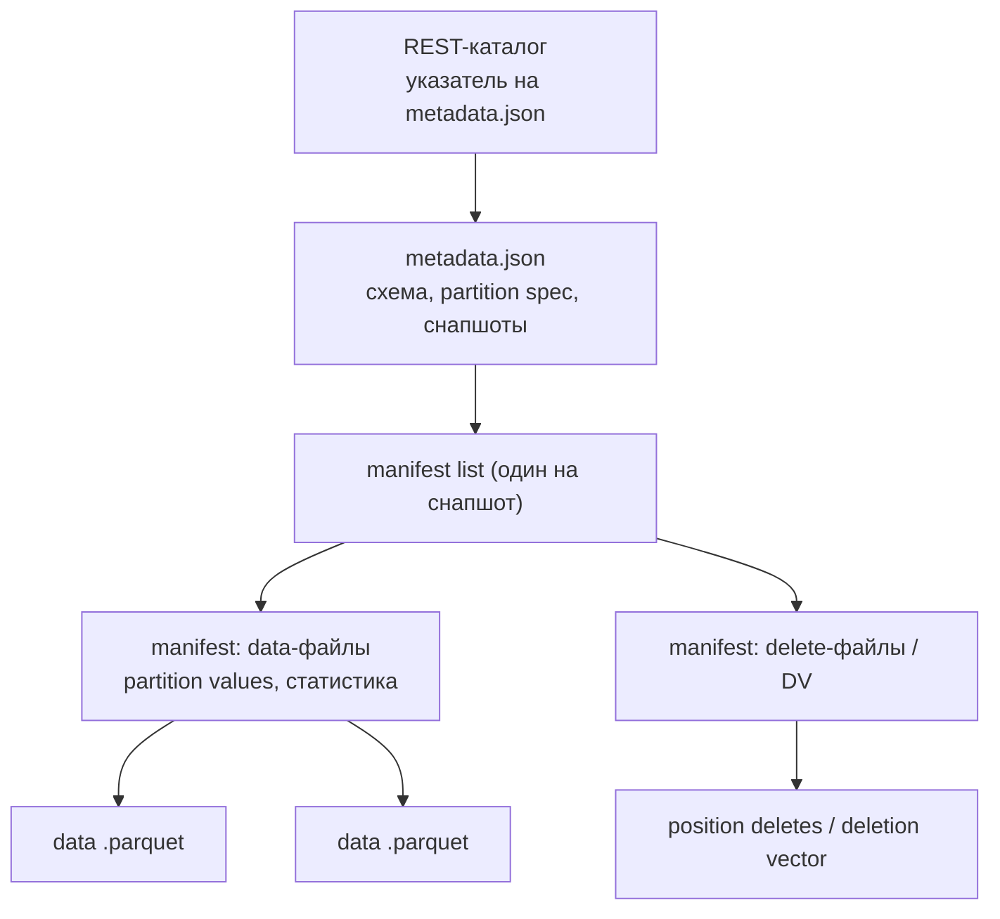
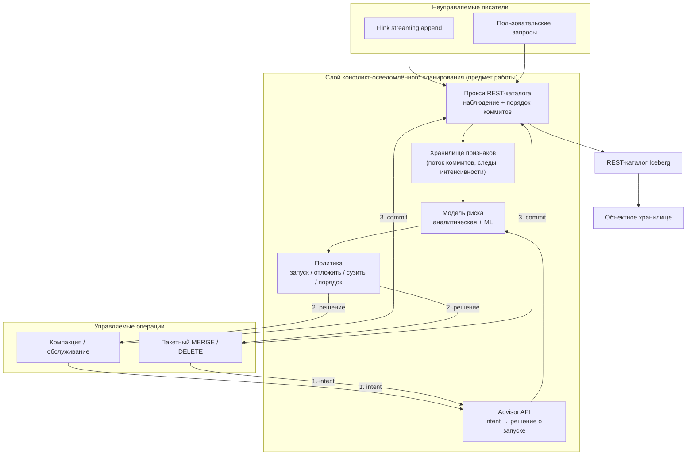

# Прогнозирование конфликтов оптимистичного контроля параллелизма и конфликт-осведомлённое планирование операций в Data Lakehouse

*Predicting Optimistic Concurrency Control Conflicts and Conflict-Aware Scheduling of Write and Maintenance Operations in a Data Lakehouse (Apache Iceberg)*

> Версия 2 (октябрь 2026). Тема уточнена по результатам проверки релевантности и новизны. Что изменилось относительно версии 1 и почему — в [docs/00_validation_report.md](docs/00_validation_report.md). Техническое задание на реализацию — в каталоге [tz/](tz/README.md).

---

## Краткая формулировка

Open Table Formats (Apache Iceberg, Delta Lake, Apache Hudi) реализуют ACID-таблицы поверх объектного хранилища с помощью оптимистичного контроля параллелизма (Optimistic Concurrency Control, OCC). При совместной работе потоковой загрузки, пакетных MERGE/CDC-операций, удалений и фоновых задач обслуживания (компакция, переписывание delete-файлов) часть операций завершается конфликтом данных уже после того, как вычисления выполнены и файлы записаны. В индустрии такие конфликты обрабатываются реактивно (повтор, backoff) или ручными эвристиками (разведение по партициям, окна обслуживания).

В данной работе предлагается метод, который **до запуска** операции оценивает вероятность её конфликта по наблюдаемому потоку коммитов и декларируемому «следу» операции (множество партиций и файлов, тип, ожидаемая длительность), и на основе этой оценки **планирует** операцию: выбирает момент запуска, сужает область действия и при одновременном завершении нескольких операций определяет порядок коммитов так, чтобы проигравшей оказалась более дешёвая. Метод реализуется как внешний (non-invasive) слой над REST-каталогом Iceberg и не меняет формат таблицы и гарантии изоляции.

Цель — показать, что конфликты OCC в lakehouse предсказуемы до момента коммита, и что конфликт-осведомлённое планирование снижает объём непроизводительных вычислений при сохранении заданного уровня обслуживания таблиц (без «тривиального» решения — откладывать компакцию бесконечно).

---

## 1. Введение

Data Lakehouse объединяет масштабируемость озера данных и транзакционные гарантии хранилища: данные хранятся в неизменяемых Parquet-файлах в объектном хранилище, а слой метаданных формата таблицы (Iceberg, Delta, Hudi) обеспечивает snapshot isolation, time travel и эволюцию схемы. Транзакционность обеспечивается OCC: операция работает без блокировок, а проверка конфликта выполняется в момент коммита через атомарную операцию compare-and-swap (CAS) над указателем на текущий снапшот таблицы. Модель построена на допущении, что конфликты редки.

Это допущение нарушается в near-real-time сценариях. Потоковая загрузка (Apache Flink, Spark Structured Streaming, Kafka Connect) коммитит каждые 5–60 секунд; CDC-пайплайны выполняют MERGE по многим партициям; задачи обслуживания переписывают файлы тех же партиций; удаления по требованиям регуляторов затрагивают произвольные наборы файлов. Конфликт данных обнаруживается в конце операции, поэтому вся выполненная работа теряется, а записанные файлы становятся orphan-файлами до следующей уборки.

Практическая значимость подтверждается индустриальными источниками. Документация AWS Glue фиксирует, что оптимизатор компакции автоматически приостанавливается после четырёх подряд неудачных запусков [I3]. В статье LinkedIn об автоматической компакции AutoComp отмечено, что компакция, запущенная параллельно с пользовательскими записями, вызывает конфликты и повторы, а предсказывать потенциальные конфликты сложно [L5]; на практике партиции там компактируются последовательно. Появились коммерческие «автономные плоскости управления» обслуживанием Iceberg, которые позиционируют обход активных писателей как основную функцию [I8], однако они опираются на эвристики и закрыты.

Актуальность усиливается двумя тенденциями 2025–2026 годов. Во-первых, REST-каталог стал стандартной точкой коммита для Iceberg (Polaris, Lakekeeper, Gravitino, Unity Catalog), а Databricks перенёс координацию коммитов Delta и Iceberg в каталог (catalog commits) [I9]. Каталог превращается в плоскость управления, в которую естественно встраивается логика планирования. Во-вторых, растёт число одновременных писателей (в том числе программных агентов), и вопрос «как не терять работу при конкурентной записи» становится массовым [I10].

---

## 2. Обзор литературы и существующих решений

Обзор разделён на четыре группы: (2.1) предсказание и планирование конфликтов в классических СУБД — идея проработана; (2.2) транзакции и конкурентность в lakehouse — исследования решают другие задачи; (2.3) механизмы форматов и индустриальные практики — реактивные и ручные; (2.4) смежные работы по автоматизации обслуживания таблиц. Полная таблица проверки источников — в [docs/00_validation_report.md](docs/00_validation_report.md).

### 2.1. Предсказание конфликтов и планирование транзакций в СУБД

| Работа | Что решает | Связь с данной работой |
| --- | --- | --- |
| Sheng, Zhang, Pavlo, Tomasic. *Scheduling OLTP Transactions via Learned Abort Prediction* (aiDM@SIGMOD 2019) [L1] | Модель предсказания аборта транзакции; конфликтующие транзакции не выполняются одновременно | Исходная идея «predict-then-schedule» |
| Zhang, Tomasic, Pavlo. *Intelligent Transaction Scheduling via Conflict Prediction in OLTP DBMS* (2024) [L2] | Статистика по «ссылкам» транзакций (атрибут-оператор-значение) в абортированных и успешных транзакциях; группировка вероятно конфликтующих транзакций в одну очередь. Для TPC-C/OCC доля абортов снижена с 45% до 6%, throughput выше на ~30% при 20 потоках | Признаки «след операции + история конфликтов» переносятся на партиции и файлы |
| Cheng et al. *Towards Optimal Transaction Scheduling* (PVLDB 17, 2024) [L3] | Поиск расписания с минимальным makespan (SMF), MVSchedO; подсказки о «горячих» ключах при старте транзакции; до 3.9× throughput в RocksDB | Идея «подсказок при старте» → декларация следа операции (intent) |
| Ding, Kot, Gehrke. *Improving OCC Through Transaction Batching and Operation Reordering* (PVLDB 12, 2018) [L4] | Батчинг и переупорядочивание перед валидацией снижают долю абортов | Порядок коммитов как управляемый рычаг |
| Pan et al. *CCaaLF: Concurrency Control as a Learnable Function* (2025) [L6] | Алгоритм CC как обучаемая функция «состояние → действие», перенастройка при дрейфе нагрузки | Обучаемая политика, реакция на дрейф |
| Mao et al. *Epoch-based OCC in Geo-replicated Databases* (Minerva, 2026) [L7] | Детерминированное перевыполнение вместо аборта, граф конфликтов | Альтернатива аборту; в lakehouse неприменима напрямую |
| Thomasian. *Concurrency Control: Methods, Performance, and Analysis* (ACM CSUR, 1998) [L8] | Аналитические модели вероятности конфликта в OCC и 2PL | Основа аналитической (пуассоновской) модели в §6.2 |

Вывод по группе: идея «оценить вероятность конфликта → запланировать так, чтобы его избежать» проработана для in-memory OLTP, где транзакции длятся миллисекунды, единица конфликта — строка или ключ, а рычаг — распределение по потокам.

### 2.2. Транзакции и конкурентность в Data Lakehouse

| Работа | Что решает | Чего не делает |
| --- | --- | --- |
| Armbrust et al. *Delta Lake* (VLDB 2020) [L9] | OCC через атомарную запись в транзакционный лог | — |
| Jain et al. *Analyzing and Comparing Lakehouse Storage Systems* (CIDR 2023) [L10] | Сравнение Delta/Hudi/Iceberg; все используют OCC и snapshot isolation | Не исследует потери от конфликтов |
| Camacho-Rodríguez et al. *LST-Bench* (SIGMOD 2024) [L11] | Бенчмарк log-structured tables, в том числе с конкурентным обслуживанием | Измеряет, но не управляет |
| Götz, Ritter, Giceva. *LakeVilla* (2025) [L12] | Non-invasive слой: recovery после аборта (undo/redo), мульти-табличные транзакции, изоляция для долгих читателей; накладные расходы ~2% | Конфликты обрабатываются реактивно; планировщика и предсказания нет; прототип только для Delta |
| Oh, Nilangekar, Deshpande. *TreeCat* (2025) [L13] | Отдельный каталог с MVOCC и точной детекцией конфликтов по предикатам; коммит ~10 мс против ~250 мс у Iceberg | Снижает ложные конфликты на уровне каталога, но не планирует операции |
| Tagliabue et al. *Building a Correct-by-Design Lakehouse* (Bauplan, 2026) [L14] | Атомарность на уровне пайплайна через ветки и контракты данных | Корректность, а не потери под нагрузкой |

Вывод по группе: исследования lakehouse сосредоточены на гарантиях (мульти-табличность, recovery, корректность) и производительности каталога, но не на предсказании конфликтов и планировании операций.

### 2.3. Механизмы форматов и индустриальные практики

| Источник | Механизм | Характер |
| --- | --- | --- |
| Iceberg: retry-свойства (`commit.retry.*`), уровни изоляции `write.{delete,update,merge}.isolation-level`, `where` в `rewrite_data_files`, `partial-progress` [I1, I2, I3] | Повтор CAS; сужение области компакции вручную | Реактивный / ручной |
| Iceberg Flink TableMaintenance (1.8+) и post-commit maintenance в IcebergSink (1.11) [I4] | Обслуживание внутри потокового джоба, блокировки между задачами обслуживания | Координация только внутри одного джоба |
| Hudi Early Conflict Detection (RFC-56) [I5] | Обнаружение уже существующего пересечения по маркерам во время записи, ранний аборт | Детерминированный, реактивный; только Hudi |
| Hudi Non-Blocking Concurrency Control (1.0) [I6] | Писатели не конфликтуют: лог-файлы в общей file group, упорядочивание по времени завершения | Изменение формата; только MOR с bucket-индексом |
| Paimon: write-only писатели + dedicated compaction [I7] | Архитектурное разделение записи и компакции | Изменение архитектуры, не применимо к Iceberg/Delta |
| Delta: WriteSerializable, row-level concurrency, catalog commits [I9, I11] | Более тонкая детекция конфликтов; каталог как координатор | Детекция, не планирование |
| LakeOps (коммерческий продукт, 2026) [I8] | Мониторинг активности писателей, компакция «холодных» партиций, последовательное обслуживание | Эвристический, закрытый, без количественной оценки |
| AWS Big Data Blog (2025) [I3], Hudi blog (2025) [I12], Dremio (2026) [I2] | Рекомендации: окна обслуживания, исключение свежих партиций, повторы с jitter | Ручные эвристики |

Вывод по группе: в индустрии конфликты либо обрабатываются после возникновения (retry, ранний аборт), либо устраняются изменением формата/архитектуры (NBCC, Paimon), либо обходятся эвристиками разведения. Количественной модели вероятности конфликта и планирования по ожидаемым потерям нет; в работе LinkedIn прямо отмечено, что предсказание конфликтов затруднительно [L5].

### 2.4. Смежные работы по автоматизации обслуживания таблиц

| Работа | Что предсказывает | Учитывает ли конфликты |
| --- | --- | --- |
| AutoComp (LinkedIn, SIGMOD 2025) [L5] | Выгоду компакции (сокращение числа файлов) и её стоимость; выбор top-k кандидатов в бюджете | Нет; отмечает конфликты как проблему |
| Smart Compaction (arXiv 2608.08639, 2026) [L15] | Долю сокращения файлов по метаданным манифестов (XGBoost) | Нет |
| Decima (SIGCOMM 2019) [L16] | Обучаемое планирование DAG-джобов в Spark-кластере | Не рассматривает транзакционные конфликты |

Вывод: выгода компакции уже предсказывается, а риск её конфликта — нет. Предлагаемая работа дополняет AutoComp-подобные системы недостающим членом целевой функции — ожидаемыми потерями от конфликта.

---

## 3. Постановка задачи

### 3.1. Неформальная постановка

Пусть таблица Iceberg разбита на партиции, а над ней одновременно выполняются операции разных типов: потоковые добавления, пакетные MERGE/UPDATE/DELETE, переписывание партиций, компакция и другие задачи обслуживания. Часть операций управляемая (запуск планирует платформа: обслуживание, пакетные MERGE, удаления по регламенту), часть — неуправляемая (потоковые писатели, пользовательские запросы). Требуется:

1. по наблюдаемому потоку коммитов и следу операции оценить вероятность того, что операция завершится конфликтом данных или исчерпанием повторов;
2. используя оценку, выбрать для управляемых операций момент запуска, область действия и порядок коммитов, минимизируя ожидаемые потери вычислений;
3. не нарушать гарантии изоляции и не накапливать «долг обслуживания» сверх заданного порога.

### 3.2. Формальная постановка

Обозначим через $\mathcal{P}$ множество партиций таблицы, через $o$ — операцию с характеристиками:

- $\tau(o)$ — тип операции (append, overwrite, CoW/MoR delete/update/merge, rewrite_data_files и т. д.);
- $F(o) \subseteq \mathcal{P}$ — след операции (партиции, файлы которых операция читает или удаляет);
- $t_s(o)$, $D(o)$ — момент запуска и длительность до попытки коммита;
- $c(o)$ — стоимость операции (CPU-секунды исполнителей, объём записанных байт);
- $b(o)$ — польза операции (для компакции — сокращение числа мелких файлов).

Исход операции $y(o) \in \{\text{commit}, \text{data\_conflict}, \text{retry\_exhausted}\}$. Требуется построить оценку

$$\hat p(o) = P\bigl(y(o) \ne \text{commit} \mid \tau(o), F(o), t_s(o), \hat D(o), \mathcal{H}_{t_s}\bigr),$$

где $\mathcal{H}_{t_s}$ — история коммитов таблицы до момента $t_s$, и политику $\pi$, выбирающую для управляемых операций решение $a \in \{\text{запустить}, \text{отложить на } \Delta, \text{сузить } F \to F'\}$, а в момент коммита — порядок допуска коммитов. Целевая функция:

$$\min_{\pi}\ \mathbb{E}\Bigl[\sum_{o} \mathbb{1}[y(o) \ne \text{commit}] \cdot c(o)\Bigr] \quad \text{при}\quad \text{Debt}_\pi(t) \le \text{Debt}_{\max},\ \ \text{Delay}_\pi(o) \le \text{SLA}(\tau(o)),$$

где $\text{Debt}$ — долг обслуживания (например, средняя доля мелких файлов в партиции или число delete-файлов на data-файл), а ограничение на задержку защищает от бесконечного откладывания. Изоляция обеспечивается каталогом: слой может только задерживать запуск или коммит, но не изменяет и не отклоняет запросы.

### 3.3. Ограничения

- Отсутствие разметки: метки исходов собираются автоматически из журнала выполнения операций.
- Неинвазивность: формат таблицы, клиенты Iceberg и каталог не модифицируются; управление — через прокси перед REST-каталогом и advisory-API для планировщика задач.
- Масштаб: все эксперименты должны воспроизводиться на одном ПК (Docker Compose); результаты для промышленного масштаба получаются на откалиброванном симуляторе.

---

## 4. Архитектура Data Lakehouse и природа конфликта

### 4.1. Слои таблицы Iceberg поверх объектного хранилища



Каждая запись создаёт новый снапшот, не изменяя существующие файлы. Чтение выполняет распределённый движок (Spark, Trino), который получает текущий снапшот у каталога и планирует сплиты по манифестам. В формате v3 позиционные delete-файлы заменяются deletion vectors (Puffin), что уменьшает число delete-файлов, но не меняет логику конфликтов.

### 4.2. Коммит и место проверки конфликта

```mermaid
sequenceDiagram
  autonumber
  participant W as Писатель (клиент Iceberg)
  participant S3 as Объектное хранилище
  participant Cat as REST-каталог
  W->>Cat: loadTable → базовый снапшот S_n
  W->>S3: записать data/delete-файлы и манифесты
  W->>Cat: POST commit (requirements: assert-ref-snapshot-id = S_n; updates: add-snapshot)
  alt текущий снапшот = S_n
    Cat-->>W: 200, current = S_{n+1}
  else другой писатель уже закоммитил
    Cat-->>W: 409 CommitFailedException
    W->>Cat: loadTable (обновить)
    W->>W: валидация на клиенте: есть ли конфликтующие изменения после S_n?
    alt нет
      W->>Cat: повторный POST commit поверх нового снапшота
    else есть (data conflict)
      W-->>W: ValidationException — операция прервана, файлы становятся orphan
    end
  end
```

Важное для реализации наблюдение: **проверка конфликта данных выполняется на стороне клиента**. Каталог видит только ответы 409 и повторные запросы; факт аборта (`ValidationException`) до каталога не доходит. Поэтому прокси перед каталогом не может самостоятельно получить метки исходов — их необходимо собирать на стороне исполнителя операций (§6.4). Кроме того, к моменту запроса коммита вычисления уже выполнены, поэтому управление только в момент коммита не может предотвратить потери — оно может лишь выбрать, какая из конфликтующих операций проиграет. Предотвращение возможно только при управлении **моментом запуска** операции.

### 4.3. Таксономия конфликтов

Выделяются два класса исходов:

- **К1 — конфликт каталога** (CAS отклонён, 409). Устраняется повтором; приводит к росту латентности и повторной записи метаданных. Становится отказом (`CommitFailedException`) только при исчерпании повторов (`commit.retry.num-retries`, по умолчанию 4) при высокой частоте коммитов.
- **К2 — конфликт данных** (`ValidationException`). Не устраняется повтором внутри Iceberg; вся работа операции теряется.

Матрица попарных исходов для Iceberg (Spark, уровень изоляции по умолчанию `serializable`) при пересечении следов операций. Матрица построена по семантике валидаций Iceberg 1.10–1.12 и подлежит эмпирическому подтверждению на этапе 1 реализации (это самостоятельный результат работы):

| Ожидающая операция ↓ / закоммиченная ранее → | Append | Overwrite / CoW D/U/M | MoR D/U/M | rewrite_data_files |
| --- | --- | --- | --- | --- |
| **Append** (в т. ч. потоковый, equality deletes Flink upsert) | К1 | К1 | К1 | К1 |
| **Overwrite / CoW DELETE/UPDATE/MERGE** | К2 при `serializable` (новые файлы в области фильтра); К1 при `snapshot` | К2 | К2 (новые delete для прочитанных файлов) | К2 (прочитанные файлы удалены) |
| **MoR DELETE/UPDATE/MERGE** | К2 при `serializable`; К1 при `snapshot` | К2 (файлы, на которые ссылаются удаления, исчезли) | К2 для одного файла (в v3 — один DV на файл) | К2 |
| **rewrite_data_files** (компакция) | **К1** | К2 | К2 (новые position deletes/DV для переписываемых файлов) | К2 при пересечении групп |

Следствия для темы:

1. Сценарий «компакция × чистый потоковый append», приведённый в версии 1 как основной источник конфликтов данных, в Iceberg порождает только К1: `RewriteFiles` не проверяет добавленные файлы, а при `use-starting-sequence-number=true` (значение по умолчанию) компакция не конфликтует и с equality deletes потокового upsert. Реальные потери в этом сценарии возникают при исчерпании повторов (К1 → отказ) или если поток выполняет MERGE (типичный CDC-паттерн `foreachBatch` + MERGE).
2. Основные источники К2: компакция × MERGE/UPDATE/DELETE (в обе стороны, «первый закоммитивший выигрывает»), MERGE/overwrite × потоковый append при `serializable`, удаления × удаления.
3. Для пар с симметричным исходом порядок коммитов определяет проигравшего — это даёт рычаг «выбора жертвы» по стоимости.

### 4.4. Orphan-файлы

Абортированная операция оставляет в хранилище data-, delete- и manifest-файлы, на которые не ссылается ни один снапшот. Они удаляются только процедурой `remove_orphan_files` с порогом возраста (по умолчанию 3 дня), так как более ранняя уборка может удалить файлы ещё не завершённых записей. Снижение доли абортов уменьшает объём orphan-файлов и нагрузку на уборку — это дополнительная измеримая польза.

---

## 5. Сценарии нагрузки

| ID | Сценарий | Класс конфликта | Стоимость проигрыша |
| --- | --- | --- | --- |
| S1 | Компакция × потоковый append (высокая частота коммитов) | К1, исчерпание повторов | Повтор компакции |
| S2 | Компакция × CDC MERGE (CoW) по пересекающимся партициям | К2, симметричный | Часы компакции или пакет CDC |
| S3 | Компакция × MoR DELETE/UPDATE (deletion vectors) | К2, симметричный | Компакция |
| S4 | Пакетный MERGE/overwrite × потоковый append, `serializable` | К2, проигрывает MERGE | Пакет MERGE |
| S5 | Регламентное удаление (compliance DELETE) × загрузка | К2 | Долгое удаление |
| S6 | Смешанная нагрузка с дрейфом интенсивности (суточный профиль) | К1 + К2 | Все перечисленное |

Общая черта сценариев: пересечение определяется partition spec, распределением ключей, расписанием задач и периодичностью потоков — то есть наблюдаемыми признаками. Это и является основанием считать конфликт предсказуемым.

---

## 6. Предлагаемый метод

### 6.1. Архитектура: двухуровневое управление



- **Уровень запуска (advisor).** Управляемая операция перед стартом регистрирует намерение (intent): таблица, тип, предикат области, оценка объёма. Advisor возвращает решение: запустить сейчас, отложить на $\Delta$, сузить область (исключить партиции с высоким риском). Это единственный уровень, на котором потери действительно предотвращаются.
- **Уровень коммита (прокси).** Прокси перед REST-каталогом наблюдает все коммиты (в том числе неуправляемых писателей) и строит из них признаки. Если две зарегистрированные операции с симметричным конфликтом приближаются к коммиту одновременно, прокси на ограниченное время (не больше $\tau_{\max}$, меньше клиентского таймаута) задерживает коммит более дешёвой, чтобы первой закоммитилась более дорогая. Прокси никогда не изменяет и не отклоняет запросы, поэтому корректность обеспечивается CAS каталога.
- **Пассивный режим.** Без интеграции с планировщиком слой работает как система оценки риска (наблюдение и прогноз), что уже полезно для мониторинга.

### 6.2. Аналитическая модель вероятности конфликта

Пусть $\lambda_{k,p}(t)$ — интенсивность коммитов класса $k$, затрагивающих партицию $p$, а $q_{k,p}$ — вероятность того, что такой коммит действительно пересекается с операцией на уровне файлов. Множество конфликтующих классов $K(\tau)$ задаётся матрицей §4.3 с учётом уровня изоляции. Тогда в предположении неоднородного пуассоновского потока коммитов

$$P_{\text{K2}}(o) = 1 - \exp\Bigl(-\sum_{p \in F(o)} \sum_{k \in K(\tau(o))} q_{k,p} \int_{t_s}^{t_s + D(o)} \lambda_{k,p}(t)\,dt\Bigr).$$

Для периодических писателей (потоковые чекпойнты) интенсивность заменяется детерминированным расписанием. Вероятность исчерпания повторов (К1) оценивается по интенсивности всех коммитов таблицы в окне коммита и длительности одной попытки. Модель интерпретируема, не требует обучения и служит базовой линией и источником признаков для ML-модели.

Ожидаемые потери решения $a$: $\mathbb{E}[W(o,a)] = \hat p(o,a)\cdot c(o)$, а критерий выбора — максимум $b(o,a) - \mathbb{E}[W(o,a)]$ при соблюдении ограничений на долг обслуживания и задержку.

### 6.3. Обучаемая модель

Модель (градиентный бустинг с калибровкой вероятностей; в качестве альтернативы — модель выживаемости для времени до конфликтующего коммита) уточняет аналитическую оценку по признакам:

| Группа | Признаки |
| --- | --- |
| Операция | тип, уровень изоляции, режим CoW/MoR, число партиций и файлов в следе, байты, предсказанная длительность $\hat D$ |
| Поток коммитов | интенсивность коммитов по классам в партициях следа (EWMA за 1/5/15 мин), период и фаза потоковых писателей, время с последнего коммита в партиции |
| Конкуренты | число активных зарегистрированных операций с пересекающимся следом, их ожидаемое время завершения |
| История | доля конфликтов в партициях и для пар типов, число повторов в последних коммитах |
| Аналитика | $P_{\text{K2}}$ и $P_{\text{K1}}$ из §6.2 |

Отдельно решается подзадача регрессии длительности $\hat D(o)$ (от объёма данных и загрузки кластера), так как от неё напрямую зависит вероятность.

### 6.4. Сбор меток

Метки исходов собираются исполнителем операций: каждая операция получает идентификатор, передаваемый в свойствах снапшота и в HTTP-заголовке запросов каталога; исполнитель записывает итог (commit, `ValidationException`, `CommitFailedException`), время и стоимость (CPU-время исполнителей Spark). Прокси добавляет к журналу все попытки коммита и ответы каталога. Объединение двух журналов даёт размеченный набор данных без ручной разметки.

### 6.5. Политики для сравнения

| Политика | Описание |
| --- | --- |
| P0 | Чистый OCC (настройки по умолчанию) |
| P1 | Увеличенные повторы и backoff (рекомендации AWS) |
| P2 | Статическое разведение: компакция только партиций старше N (`where`-фильтр) |
| P3 | Фиксированные окна обслуживания |
| P4 | Реактивная эвристика: исключать партиции с коммитами за последние $\Delta$ (аналог коммерческих решений) |
| P5 | Аналитическая модель + решение о запуске/сужении |
| P6 | ML-модель + решение о запуске/сужении + порядок коммитов |
| P★ | Оракул, знающий исход заранее (верхняя граница выигрыша) |

---

## 7. Научная новизна

1. **Количественная модель вероятности конфликта для операций lakehouse** — пуассоновская модель с матрицей конфликтов по типам операций и уровням изоляции, учитывающая длительность операций (секунды–часы) и партиционную гранулярность. В литературе такие модели существуют для OLTP [L8], а для lakehouse отмечено, что предсказание конфликтов затруднительно [L5].
2. **Метод конфликт-осведомлённого планирования** с явной целевой функцией «ожидаемые потери вычислений при ограничении на долг обслуживания», объединяющий решение о запуске, сужение области и выбор проигравшего при одновременном коммите. Существующие решения либо реактивны [I1–I5], либо меняют формат [I6, I7], либо эвристичны и закрыты [I8].
3. **Неинвазивная реализация** на уровне REST-каталога Iceberg с доказуемым сохранением изоляции (слой только задерживает, но не изменяет запросы), проверенная на двух реализациях каталога.
4. **Эмпирически подтверждённая матрица конфликтов Iceberg и открытый воспроизводимый стенд** с генератором нагрузки и набором трасс коммитов, а также откалиброванный дискретно-событийный симулятор для оценки на промышленном масштабе.

---

## 8. Гипотезы и метрики

- **H1.** Исход операции (коммит / конфликт данных / исчерпание повторов) предсказуем до её запуска: ML-модель достигает PR-AUC ≥ 0.80 и Brier score ниже, чем у аналитической модели и реактивной эвристики.
- **H2.** Конфликт-осведомлённое планирование (P5, P6) снижает непроизводительные CPU-секунды не менее чем на 30% относительно P0 и превосходит P2–P4 при одинаковом ограничении на долг обслуживания.
- **H3.** Слой не нарушает гарантии изоляции (проверяется инвариантами), а накладные расходы на латентность коммита при низкой конкурентности не превышают 5% (p50) и 10% (p95).
- **H4.** Симулятор, откалиброванный на стенде, воспроизводит долю конфликтов с ошибкой не более 10% (отн.), что позволяет переносить выводы на промышленный масштаб.

Метрики: доля операций с К2 и с отказом по К1; непроизводительные CPU-секунды и байты; goodput (полезные коммиты в единицу времени); латентность коммита p50/p95/p99; задержка запуска управляемых операций; долг обслуживания во времени (доля мелких файлов, delete-файлов на data-файл); объём orphan-файлов; качество предсказания (PR-AUC, ROC-AUC, Brier, ECE).

---

## 9. Экспериментальная методика

Эксперименты проводятся на двух уровнях:

1. **Стенд на одном ПК** (Docker Compose): объектное хранилище (SeaweedFS), REST-каталог Iceberg (reference-реализация и Lakekeeper), Spark (standalone, несколько воркеров), Kafka + Flink для потоковой загрузки, PostgreSQL для телеметрии, Prometheus/Grafana, Toxiproxy для эмуляции задержек объектного хранилища, прокси и advisor. Длительности операций масштабируются по объёму данных (минуты вместо часов).
2. **Дискретно-событийный симулятор**, реализующий семантику валидаций Iceberg на уровне партиций и файлов. Калибруется по стенду (распределения длительностей, интенсивности), проверяется на совпадение долей конфликтов и используется для параметрических прогонов и промышленного масштаба (тысячи партиций, многочасовая компакция).

Каждая конфигурация повторяется не менее 5 раз с разными зёрнами; результаты приводятся с 95% доверительными интервалами (bootstrap), различия политик проверяются критерием Манна–Уитни. Подробности — в [tz/05_workloads_and_experiments.md](tz/05_workloads_and_experiments.md).

---

## 10. Ожидаемые результаты и ограничения

Ожидаемые результаты:

- эмпирически подтверждённая матрица конфликтов Iceberg для основных пар операций;
- аналитическая и обучаемая модели риска конфликта с оценкой качества;
- прототип слоя планирования (прокси + advisor) и его сравнение с семью политиками;
- открытый стенд, генератор нагрузки, набор трасс и симулятор.

Ограничения: основной объект исследования — Iceberg (наиболее распространённый формат с открытым REST-протоколом каталога); перенос на Delta Lake обсуждается качественно (аналогичная матрица конфликтов, точка встраивания — catalog commits). Неуправляемые писатели не планируются, а только учитываются в прогнозе. Абсолютные длительности на стенде меньше промышленных; перенос обеспечивается симулятором.

---

## 11. Источники

**Научные работы**

- [L1] Sheng Y., Tomasic A., Zhang T., Pavlo A. Scheduling OLTP Transactions via Learned Abort Prediction. aiDM@SIGMOD 2019. arXiv:1903.02990
- [L2] Zhang T., Tomasic A., Pavlo A. Intelligent Transaction Scheduling via Conflict Prediction in OLTP DBMS. 2024. arXiv:2409.01675
- [L3] Cheng A., Kabcenell A., Chan J., Shi X., Bailis P., Crooks N., Stoica I. Towards Optimal Transaction Scheduling. PVLDB 17, 2024. vldb.org/pvldb/vol17/p2694-cheng.pdf
- [L4] Ding B., Kot L., Gehrke J. Improving Optimistic Concurrency Control Through Transaction Batching and Operation Reordering. PVLDB 12(2), 2018
- [L5] AutoComp: Automated Data Compaction for Log-Structured Tables in Data Lakes. SIGMOD 2025 (industrial). arXiv:2504.04186
- [L6] Pan H., Cai S., Dinh T. T. A., Wu Y., Chee Y. M., Chen G., Ooi B. C. CCaaLF: Concurrency Control as a Learnable Function. 2025. arXiv:2503.10036
- [L7] Mao Y. et al. Epoch-based Optimistic Concurrency Control in Geo-replicated Databases. 2026. arXiv:2602.21566, DOI 10.1145/3802052
- [L8] Thomasian A. Concurrency Control: Methods, Performance, and Analysis. ACM Computing Surveys 30(1), 1998
- [L9] Armbrust M. et al. Delta Lake: High-Performance ACID Table Storage over Cloud Object Stores. PVLDB 13, 2020
- [L10] Jain P. et al. Analyzing and Comparing Lakehouse Storage Systems. CIDR 2023
- [L11] Camacho-Rodríguez J. et al. LST-Bench: Benchmarking Log-Structured Tables in the Cloud. SIGMOD 2024. arXiv:2305.01120
- [L12] Götz T., Ritter D., Giceva J. LakeVilla: Multi-Table Transactions for Lakehouses. 2025. arXiv:2504.20768
- [L13] Oh K., Nilangekar P., Deshpande A. TreeCat: Standalone Catalog Engine for Large Data Systems. 2025. arXiv:2503.02956
- [L14] Tagliabue J. et al. Building a Correct-by-Design Lakehouse. 2026. arXiv:2602.02335
- [L15] Cutura J., Prakash S. Smart Compaction: Predicting Compaction Utility from Lakehouse Table Metadata. 2026. arXiv:2608.08639
- [L16] Mao H. et al. Learning Scheduling Algorithms for Data Processing Clusters (Decima). SIGCOMM 2019

**Документация и индустриальные источники**

- [I1] Apache Iceberg: Reliability, Spark Configuration (isolation levels), Maintenance, Spark Procedures. iceberg.apache.org/docs/latest
- [I2] Dremio. Apache Iceberg Concurrency: Commit Conflicts, Isolation and Retries. 2026. dremio.com/blog/apache-iceberg-concurrency-commit-conflicts
- [I3] AWS Big Data Blog. Manage concurrent write conflicts in Apache Iceberg on the AWS Glue Data Catalog. 2025; AWS Glue: Considerations and limitations (optimizer). docs.aws.amazon.com/glue/latest/dg/optimizer-notes.html
- [I4] Apache Iceberg: Flink Maintenance (TableMaintenance). iceberg.apache.org/docs/latest/flink-maintenance; Apache Iceberg 1.11.0 / 1.12.0 release notes
- [I5] Apache Hudi RFC-56: Early Conflict Detection for Multi-Writer
- [I6] Apache Hudi: Non-Blocking Concurrency Control (1.0). hudi.apache.org/blog/2025/12/16/maximizing-throughput-nbcc
- [I7] Apache Paimon: Concurrency Control, Dedicated Compaction. paimon.apache.org/docs
- [I8] LakeOps. Apache Iceberg Commit Conflicts: Causes, Prevention, and Recovery. 2026. lakeops.dev/blog/iceberg-commit-conflicts
- [I9] Databricks: Catalog commits. docs.databricks.com/aws/en/delta/catalog-commits
- [I10] Merced A. Surviving Optimistic Commit Collisions When Hundreds of Agents Write to Iceberg. 2026. datalakehousehub.com
- [I11] Databricks: Isolation levels and write conflicts; Row-level concurrency
- [I12] Mazumdar D. Concurrency Control in the Open Data Lakehouse. Apache Hudi blog, 2025
- [I13] Vanlightly J. Apache Iceberg's Consistency Model, Part 2. 2024
- [I14] Iceberg REST Catalog OpenAPI specification. github.com/apache/iceberg/blob/main/open-api/rest-catalog-open-api.yaml
