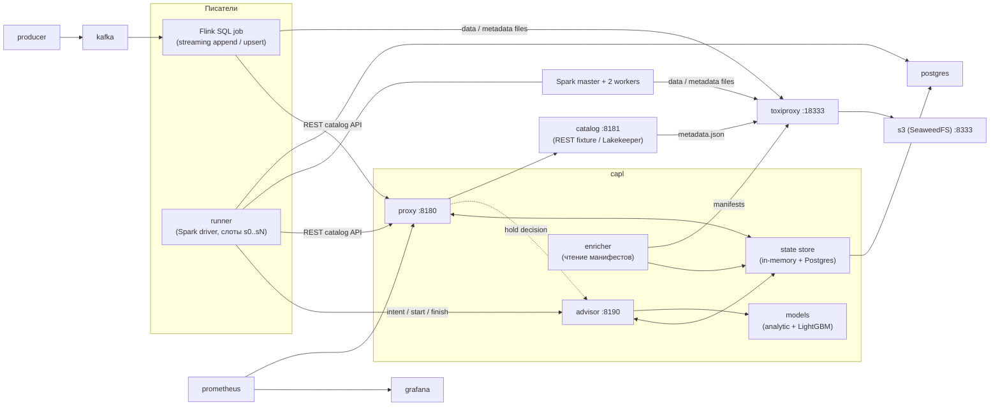
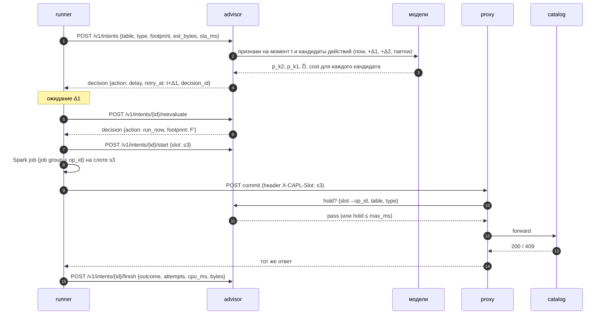
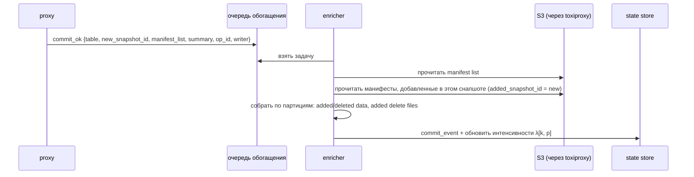
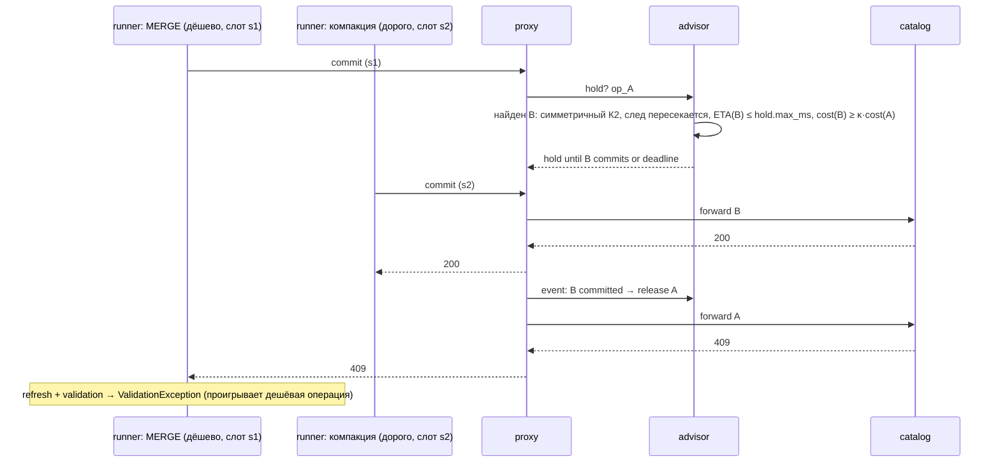

# 02. Архитектура

## 1. Компоненты стенда

| Сервис (compose) | Образ / сборка | Порты (host) | Роль |
| --- | --- | --- | --- |
| `s3` | `chrislusf/seaweedfs:${SEAWEEDFS_VERSION}` | 8333 (S3), 9333 (master UI) | Объектное хранилище (S3 API) |
| `s3-init` | `amazon/aws-cli:${AWSCLI_VERSION}` | — | Создание бакета `warehouse` (one-shot) |
| `toxiproxy` | `ghcr.io/shopify/toxiproxy:${TOXIPROXY_VERSION}` | 8474 (API), 18333 (S3 через задержку) | Эмуляция задержки объектного хранилища |
| `catalog` | `apache/iceberg-rest-fixture:${ICEBERG_VERSION}` | 8181 | Основной REST-каталог (JdbcCatalog на SQLite-файле) |
| `lakekeeper`, `lakekeeper-migrate`, `lakekeeper-bootstrap` | `quay.io/lakekeeper/catalog:${LAKEKEEPER_VERSION}` | 8182 | Альтернативный REST-каталог (профиль `lakekeeper`) |
| `capl` | `infra/capl/Dockerfile` | 8180 (прокси), 8190 (advisor), 9101 (метрики) | Предмет работы: прокси + advisor + модель |
| `spark-master` | `infra/spark/Dockerfile` | 8080 (UI), 7077 | Spark standalone master |
| `spark-worker-1`, `spark-worker-2` | `infra/spark/Dockerfile` | 8081, 8082 | Spark-воркеры |
| `runner` | `infra/spark/Dockerfile` (+ код) | 4040 (UI драйвера) | Исполнитель нагрузки (драйвер Spark в client mode) |
| `kafka` | `apache/kafka:${KAFKA_VERSION}` | 9092 | Источник событий (KRaft, один узел) |
| `producer` | `infra/capl/Dockerfile` (модуль `runner.producer`) | — | Генератор событий в Kafka |
| `flink-jobmanager`, `flink-taskmanager` | `infra/flink/Dockerfile` | 8085 (UI) | Потоковый писатель (профиль `streaming`) |
| `flink-sql` | `infra/flink/Dockerfile` | — | Отправка Flink SQL job (one-shot) |
| `postgres` | `postgres:${POSTGRES_VERSION}` | 5432 | Телеметрия CAPL/runner, БД Lakekeeper |
| `prometheus` | `prom/prometheus:${PROMETHEUS_VERSION}` | 9090 | Метрики |
| `grafana` | `grafana/grafana:${GRAFANA_VERSION}` | 3000 | Дашборды |

Профили Compose: без профиля — ядро (s3, toxiproxy, catalog, capl, spark, runner, postgres); `streaming` — kafka, producer, flink; `observability` — prometheus, grafana; `lakekeeper` — альтернативный каталог. `make up` = ядро + streaming + observability; `make up-lite` = ядро + observability (потоковая запись — Spark Structured Streaming внутри runner, Kafka заменяется генератором rate-source).

## 2. Схема развёртывания



## 3. Ключевые взаимодействия

### 3.1. Жизненный цикл управляемой операции



### 3.2. Обогащение коммита следом



Обогащение асинхронное: задержка не влияет на коммит. Для потоковых писателей с частыми коммитами чтение ограничивается манифестами со статусом ADDED/DELETED текущего снапшота (несколько небольших Avro-файлов).

### 3.3. Удержание коммита (выбор проигравшего)



## 4. Внутренняя архитектура сервиса `capl`

Один процесс Python (asyncio, uvicorn), три ASGI-приложения на разных портах и фоновые задачи:

| Модуль | Ответственность |
| --- | --- |
| `capl.proxy.app` | Starlette/FastAPI-приложение catch-all `/{path:path}`; потоковое проксирование через `httpx.AsyncClient` (пул соединений, таймауты из конфигурации); перехват коммитов |
| `capl.proxy.commit_parser` | Разбор `CommitTableRequest` и `CommitTransactionRequest` (requirements, updates, add-snapshot summary) |
| `capl.proxy.hold` | Асинхронные «ворота»: `asyncio.Event` на ожидаемую операцию, дедлайн, метрики удержаний |
| `capl.enricher` | Пул воркеров обогащения; чтение Avro-манифестов через `pyiceberg.io` / `fastavro` |
| `capl.advisor.app` | REST API по [../api/advisor.openapi.yaml](../api/advisor.openapi.yaml) |
| `capl.state` | Состояние в памяти: активные intents, назначение слотов, кольцевые буферы коммитов по таблице и партиции, интенсивности; периодический сброс в Postgres |
| `capl.features` | Вычисление признаков по `config/features.yaml`; общий для online/offline/sim |
| `capl.models.analytic` | Пуассоновская модель $P_{K2}$, $P_{K1}$ |
| `capl.models.ml` | Загрузка и инференс LightGBM, калибровка |
| `capl.policies` | P0–P6, `explore`; интерфейс `decide(intent, state, models) -> Decision` и `hold(commit, state) -> HoldDecision` |
| `capl.conflicts` | Загрузка `conflict_matrix.yaml`, функции `conflicts(a, b, isolation) -> {none, K1, K2_a_loses, K2_b_loses, K2_symmetric}` |
| `capl.telemetry` | Асинхронная запись в Postgres (`asyncpg`), батчами |
| `capl.metrics` | Prometheus-клиент |

Модель конкуренции: прокси не сериализует коммиты; каждое удержание — отдельная корутина. Состояние изменяется только в event loop (без блокировок). Тяжёлый инференс выполняется в `ThreadPoolExecutor`.

Отказоустойчивость: обращение прокси к advisor внутри процесса — вызов функции с таймаутом 20 мс; при исключении — `pass`. Если сервис `capl` недоступен целиком, runner может быть переключён в режим `bypass` (`CATALOG_URI` напрямую на каталог) — это и есть контрольная конфигурация для AC-5.

## 5. Структура репозитория

```text
nir/
├── README.md                     # тема (версия 2)
├── AGENTS.md                     # инструкции для нейросетевого ассистента
├── Makefile
├── pyproject.toml
├── docs/
│   ├── 00_validation_report.md
│   ├── CHANGELOG.md
│   ├── decisions/                # ADR
│   └── stage-N-report.md
├── tz/                           # это ТЗ
├── api/advisor.openapi.yaml
├── schemas/                      # JSON Schema событий
├── config/
│   ├── capl.yaml
│   ├── conflict_matrix.yaml
│   ├── features.yaml
│   ├── simulator.yaml
│   ├── workloads/S0_baseline.yaml … S6_mixed_drift.yaml
│   └── experiments/matrix.yaml
├── infra/
│   ├── docker-compose.yml
│   ├── .env.example
│   ├── capl/Dockerfile
│   ├── spark/{Dockerfile,spark-defaults.conf,fairscheduler.xml}
│   ├── flink/{Dockerfile,sql/streaming_append.sql,sql/streaming_upsert.sql}
│   ├── seaweedfs/s3.json
│   ├── toxiproxy/toxiproxy.json
│   ├── postgres/init/01_telemetry.sql
│   ├── prometheus/prometheus.yml
│   └── grafana/provisioning/...
├── src/
│   ├── capl/                     # сервис (см. §4)
│   ├── runner/
│   │   ├── main.py               # CLI: run --scenario --policy --seed
│   │   ├── scenario.py           # загрузка и валидация YAML (pydantic)
│   │   ├── datagen.py            # детерминированная генерация данных
│   │   ├── ops/                  # append, merge_cow, merge_mor, delete, overwrite, rewrite, expire, orphan
│   │   ├── slots.py              # пул Spark-каталогов со своими заголовками
│   │   ├── streaming.py          # Flink-отправка или Spark Structured Streaming
│   │   ├── producer.py           # генератор Kafka
│   │   ├── cost.py               # Spark REST API → CPU/run time по job group
│   │   ├── health.py             # снимки table_health
│   │   ├── invariants.py         # проверка корректности
│   │   └── orphans.py            # подсчёт orphan-файлов
│   ├── sim/
│   │   ├── engine.py             # SimPy-модель
│   │   ├── table.py              # партиции, файлы, sequence numbers
│   │   ├── catalog.py            # CAS-сервер, повторы
│   │   ├── workload.py           # те же сценарии YAML
│   │   └── calibrate.py
│   ├── ml/
│   │   ├── dataset.py            # point-in-time сборка обучающей выборки
│   │   ├── train.py
│   │   ├── evaluate.py
│   │   └── registry.py
│   └── analysis/
│       ├── metrics.py
│       ├── stats.py              # bootstrap CI, Mann–Whitney
│       └── figures.py
├── tests/
│   ├── unit/
│   ├── integration/              # требуют поднятого стенда
│   └── e2e/
├── data/traces/                  # экспорт телеметрии (Parquet), не в git (DVC/архив)
├── models/
└── results/
```

## 6. Ключевые архитектурные решения (ADR, кратко)

| ADR | Решение | Причина |
| --- | --- | --- |
| ADR-001 | Iceberg + REST-каталог как объект | Открытый протокол коммита; единая точка для прокси; поддержка всеми движками |
| ADR-002 | Двухуровневое управление (advisor + proxy) | Потери предотвращаются только при управлении запуском; прокси даёт наблюдаемость и выбор проигравшего |
| ADR-003 | Прокси только задерживает | Гарантирует сохранение изоляции; корректность Iceberg не зависит от времени доставки запросов |
| ADR-004 | Метки исходов — на стороне runner | Конфликт данных обнаруживается клиентом, каталог его не видит |
| ADR-005 | Привязка коммитов через слоты с заголовками `header.X-CAPL-Slot` | Свойства снапшота задаются не для всех SQL-операций; статический заголовок на экземпляр каталога поддерживается REST-клиентом Iceberg |
| ADR-006 | Один долгоживущий Spark-драйвер с FAIR-пулами вместо множества приложений | Экономия памяти на одном ПК; семантика конфликтов не зависит от того, в одном ли JVM выполняются операции (каждая имеет свой базовый снапшот и валидацию) |
| ADR-007 | SeaweedFS вместо MinIO | Community-редакция MinIO не поддерживается с 2025–2026 гг. |
| ADR-008 | Один код политик для advisor и симулятора | Исключает расхождение поведения «стенд/симуляция» |
| ADR-009 | Python для CAPL | Частота коммитов (до десятков в секунду) не требует нативной производительности; общий стек с ML |
